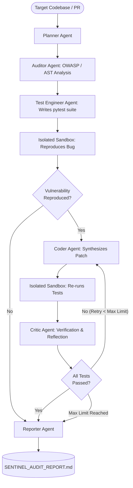

# SentinelAI: Autonomous Multi-Agent Code Audit & Self-Healing Engine

[](https://github.com/ghoshshivam670-cpu/sentinel-ai/actions/workflows/ci.yml)
[](https://www.python.org/downloads/)
[](https://github.com/langchain-ai/langgraph)
[](https://opensource.org/licenses/MIT)
[](https://langfuse.com)

> **SentinelAI** is an enterprise-grade autonomous multi-agent system that audits source code for logic bugs and security vulnerabilities (OWASP/CWE), authors isolated reproduction test suites, executes them in a sandboxed runtime, and drives an iterative self-healing reflection loop until verified patches pass all assertions.

---

## 🏗️ Architecture & State Flow

SentinelAI uses a cyclic **LangGraph StateGraph** to manage multi-agent handoffs, reflection loops, and isolated tool executions:



---

## 🚀 Key Engineering Highlights

- **Cyclical Self-Correction Loops:** Rather than naive one-shot prompting, SentinelAI executes a strict Red-Green-Refactor agentic loop: test failure $\rightarrow$ critic diagnosis $\rightarrow$ patch adjustment $\rightarrow$ verification.
- **Isolated Sandbox Execution:** Generated reproduction tests are run in isolated subprocess workspaces with CPU/wall-clock timeouts to prevent denial-of-service or malicious code execution.
- **Multi-Model Provider Support:** Built-in model factory supporting Google Gemini (`gemini-1.5-pro`), OpenAI (`gpt-4o`), and Anthropic Claude (`claude-3-5-sonnet`).
- **Production Observability:** Native integration with [Langfuse](https://langfuse.com) for end-to-end token consumption, latency traces, and prompt auditing.
- **Real-Time Streaming API:** FastAPI async backend serving Server-Sent Events (SSE) for granular step-by-step agent telemetry in frontend applications.
- **Strict Pydantic V2 Schemas:** 100% deterministic, typed schemas for vulnerabilities, patch diffs, and verdicts.

---

## 📁 Repository Structure

```
sentinel-ai/
├── sentinel/
│   ├── agents/
│   │   ├── planner.py       # Architecture breakdown & audit strategy
│   │   ├── auditor.py       # Security & logic vulnerability scanner
│   │   ├── test_gen.py      # Targeted reproduction pytest generator
│   │   ├── coder.py         # Surgical patch generator
│   │   ├── critic.py        # Reflection, diagnosis, and retry verifier
│   │   └── reporter.py      # Executive report & diff generator
│   ├── schemas/
│   │   ├── models.py        # Pydantic V2 domain models
│   │   └── state.py         # LangGraph AgentState TypedDict
│   ├── sandbox/
│   │   └── runner.py        # Subprocess isolated test execution harness
│   ├── workflow/
│   │   └── graph.py         # StateGraph assembly & conditional routing
│   ├── server/
│   │   └── app.py           # FastAPI backend with Server-Sent Events (SSE)
│   ├── observability/
│   │   └── tracer.py        # Langfuse / OpenTelemetry tracing
│   ├── config.py            # Pydantic BaseSettings & multi-provider factory
│   └── cli.py               # Rich terminal CLI interface
├── tests/
│   ├── sample_vulnerable_code/ # Real benchmark targets (SQLi, auth flaws)
│   └── test_evals.py        # Automated test & sandbox safety benchmarks
├── requirements.txt
├── .env.example
└── README.md
```

---

## ⚡ Quickstart

### 1. Clone & Set Up Virtual Environment

```bash
cd sentinel-ai
python -m venv .venv

# Windows:
.venv\Scripts\activate

# Linux/macOS:
source .venv/bin/activate

pip install -r requirements.txt
```

### 2. Configure Environment Variables

Copy `.env.example` to `.env` and provide your preferred API key:

```ini
DEFAULT_LLM_PROVIDER=gemini # or "openai", "anthropic"
MODEL_NAME=gemini-1.5-pro

# Add your API key:
GEMINI_API_KEY=your_gemini_api_key_here
# OPENAI_API_KEY=your_openai_api_key_here

# Optional: Langfuse Tracing
LANGFUSE_PUBLIC_KEY=
LANGFUSE_SECRET_KEY=
```

---

## 🖥️ Usage

### Option A: Interactive CLI

Run SentinelAI directly on any vulnerable file or directory:

```bash
python cli.py audit tests/sample_vulnerable_code/auth_service.py --max-iterations 3
```

**Terminal Output Preview:**
```text
╭──────────────── SentinelAI Autonomous Engine ─────────────────╮
│ Inspecting target: tests/sample_vulnerable_code/auth_service.py│
│ Total files ingested: 1                                       │
╰───────────────────────────────────────────────────────────────╯
PLANNER: [Planner] Architecture plan formulated. Focus areas: SQL injection, Auth logic
AUDITOR: [Auditor] Audit complete. Found 2 vulnerabilities (Risk Score: 8.5/10).
TEST_GENERATOR: [TestEngineer] Generated reproduction test suite 'test_reproduction.py'.
INITIAL_SANDBOX: [Sandbox] Vulnerability REPRODUCED! Tests failed as expected (1 failures).
CODER: [Coder] Iteration 1: Applied patch modifying 1 file(s): auth_service.py.
VERIFICATION_SANDBOX: [Sandbox] Verification run finished. Status: PASS in 0.18s.
CRITIC: [Critic] Patch ACCEPTED! All tests verified successfully in iteration 1.
REPORTER: [Reporter] Final executive security & patch report generated.

✓ Report generated successfully: SENTINEL_AUDIT_REPORT.md
```

---

### Option B: FastAPI Streaming Server

Launch the high-throughput async server:

```bash
uvicorn sentinel.server.app:app --host 0.0.0.0 --port 8000 --reload
```

Stream live agent execution via HTTP SSE:

```bash
curl -N -X POST http://localhost:8000/api/v1/audit/stream \
  -H "Content-Type: application/json" \
  -d '{
    "project_id": "auth-service",
    "code_files": {
      "auth.py": "def login(u, p): return query(f\"SELECT * FROM users WHERE u=\x27{u}\x27\")"
    },
    "max_iterations": 3
  }'
```

---

### Option C: Interactive Web Dashboard (Streamlit)

Launch the visual dashboard to test agents with a rich UI:

```bash
streamlit run app_ui.py
```

- **Live Multi-Agent Workflow:** Watch the state machine transition in real time with progress tracking.
- **Vulnerability Inspection:** Visual cards with CWE IDs, severity badges, and mitigation steps.
- **Reproduction Test Suite:** Inspect the exact pytest file generated by the Test Engineer.
- **Side-by-Side Diff:** Compare the original vulnerable code directly against the autonomously healed code.
- **One-Click Download:** Export the comprehensive audit report as Markdown.

---

### Option D: GitHub Actions Autonomous PR Review Bot

SentinelAI includes `.github/workflows/sentinel_pr_audit.yml` and `scripts/pr_audit.py` to automatically audit every Pull Request:

1. In your GitHub repository, navigate to **Settings → Secrets and variables → Actions**.
2. Add a new repository secret named `GEMINI_API_KEY`.
3. Whenever a Pull Request modifies `.py` files, SentinelAI automatically audits the diff, generates reproduction tests in an isolated sandbox, and posts a formatted review comment with the proposed self-healing patch diff directly on the PR.

---

## 🧪 Automated Benchmarks & Evals

Run the sandbox execution & workflow benchmarks:

```bash
PYTEST_DISABLE_PLUGIN_AUTOLOAD=1 pytest tests/test_evals.py -v
```

---

## 📜 License

MIT License. Built for Production AI Engineering.
